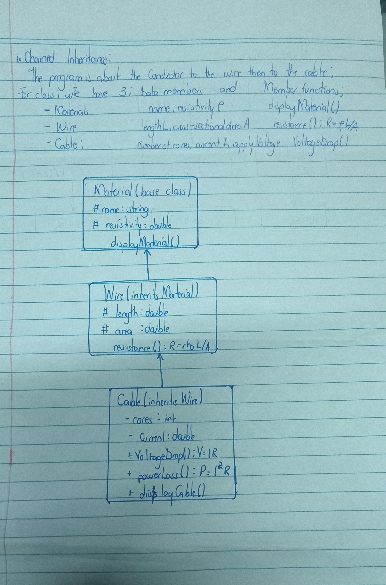

>The program i designed helps the user whether a cable of a given length and size loses too much voltage or wastes too much power as heat.

A Cable object can use functions from all three levels; that is: displayMaterial() from the grandparent, resistance() from the parent, and powerLoss() from itself.
Constructors run top-down that is, Material, then Wire, then Cable.
Code is written once and reused, not repeated in each class.

**Below is the diagram for the polymophism block**
