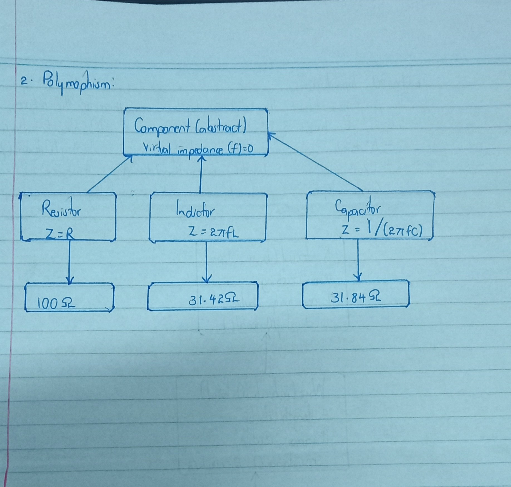

> This program helps find the opposition to AC current / impedence of different circuit components using one identical function call.
> It helps analyse AC circuits where a mix of components must all be handled the same way.

One base-class pointer (Component*) can point to any of the three component types.
The call parts[i]->impedance(f) is written once, but C++ picks the correct version at runtime based on the actual object and this is what virtual does.
A new component, such as a diode or a transformer, can be added without changing the loop in main().

